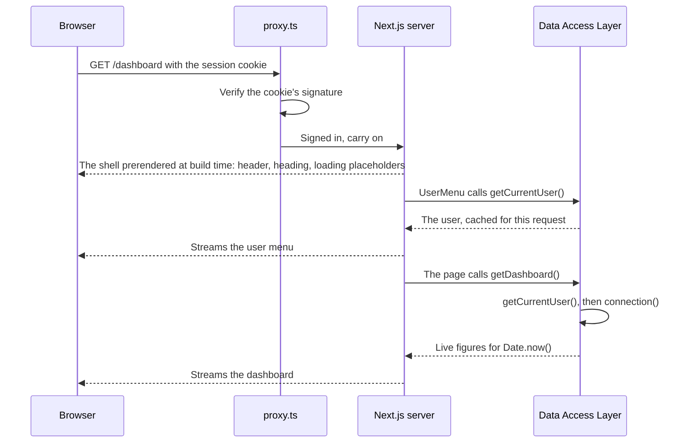
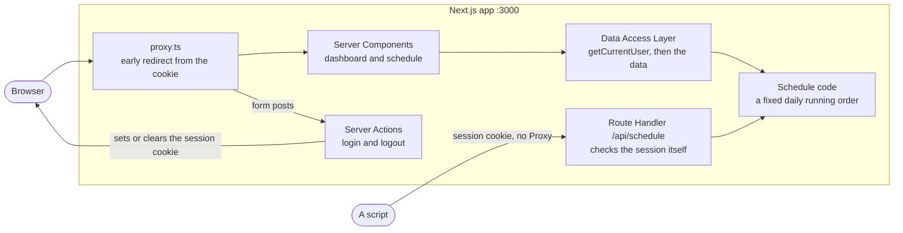

# Tutorial 2: Next.js App Router

Build the same broadcast-schedule app as Tutorial 1, this time with Next.js: a login page, a dashboard of what is on air, and a day view of the schedule by channel. There is no separate API project. The server code lives in the same app, and one Route Handler exposes a small JSON API for other clients.

This tutorial assumes you have done [Tutorial 1](https://github.com/howardpanton/schedule-react), and points out where Next.js does things differently. You will cover Server and Client Components, Server Actions, Cache Components and Partial Prerendering, the Data Access Layer pattern for authorisation, Proxy, Route Handlers, and how to test all of it.

**Time:** about three hours, in three sittings: steps 1 to 5, 6 to 10, then 11 to 15.

## How to follow along

- Work in `~/Sites/learn`. Step 1 puts this repository there.
- Commit at the end of each step, so you can always get back to a working state.
- A finished copy of this app is on your machine at `~/Sites/react-next-refresher/schedule-next`. Every file in this tutorial is copied from it, and it passes lint, typecheck, unit tests, a production build and end-to-end tests. If something doesn't work, compare your code with it:

  ```bash
  diff -ru --exclude=node_modules ~/Sites/react-next-refresher/schedule-next/src ~/Sites/learn/schedule-next/src
  ```

- The demo login is `demo@example.com` / `password123`.

### Steps

1. [Create the app and the repository](#1-create-the-app-and-the-repository)
2. [Formatting and scripts](#2-formatting-and-scripts)
3. [The shared schedule code](#3-the-shared-schedule-code)
4. [Sessions, users and the Data Access Layer](#4-sessions-users-and-the-data-access-layer)
5. [The login page](#5-the-login-page)
6. [Proxy: an early redirect](#6-proxy-an-early-redirect)
7. [The signed-in layout](#7-the-signed-in-layout)
8. [The dashboard](#8-the-dashboard)
9. [The schedule view](#9-the-schedule-view)
10. [The JSON API: a Route Handler](#10-the-json-api-a-route-handler)
11. [Unit and component tests](#11-unit-and-component-tests)
12. [End-to-end tests with Playwright](#12-end-to-end-tests-with-playwright)
13. [The build file: GitHub Actions](#13-the-build-file-github-actions)
14. [Build for production](#14-build-for-production)
15. [Code review with Claude Code](#15-code-review-with-claude-code)

After step 15, [the two tutorials side by side](#the-two-tutorials-side-by-side) compares the React and Next.js versions.

<!-- checks-intro -->
> **How the checks work**
>
> This tutorial has 5 checks. They add about 65 minutes, and they're where you practise designing rather than typing.
>
> - **Decision** checks stop at a real design choice. Decide first, then open the answer.
> - **Predict** checks ask what will happen before you run something.
> - **Break it** checks have you remove a safeguard on purpose and see what catches it.
> - **Write it** checks give you the test, not the code.
>
> Not every tutorial uses all four kinds.
>
> Write your answers in `docs/decisions.md` in your own repository before you open anything. Being wrong first is how the lesson sticks. If the repository checks formatting, run its formatter on that file before you commit it.
<!-- /checks-intro -->

## What you need

- Node 24, Git and the GitHub CLI, as in Tutorial 1.
- `openssl`, for generating a secret (built into macOS and Linux).

## How Next.js differs from the Vite app

| Tutorial 1 (React + Vite)                  | Tutorial 2 (Next.js)                                                                         |
| ------------------------------------------ | -------------------------------------------------------------------------------------------- |
| Everything renders in the browser          | Components render on the **server** by default; you opt into the browser with `"use client"` |
| A loader fetches data from the API         | An `async` Server Component reads the data directly, with no API call                        |
| A route `action` posts to the API          | A **Server Action**: a server function the form calls directly                               |
| A separate Hono API                        | **Route Handlers** in `app/api`, for clients that aren't your pages                          |
| Random session id stored on the API        | A signed session token in an `httpOnly` cookie                                               |
| A layout loader redirects signed-out users | **Proxy** redirects early; a **Data Access Layer** enforces it                               |
| `lazy` routes for code splitting           | Automatic: every route is split                                                              |
| One `index.html` shell                     | **Partial Prerendering**: a static shell per page, with dynamic parts streamed in            |

### What is new in Next.js 16

If you last used Next.js 13 or 14, these are the changes you will meet in this tutorial:

- **Cache Components** is on by default in new apps. Nothing is cached unless you say so with `"use cache"`, and anything that reads the request (cookies, search params, the current time) must sit inside a `<Suspense>` boundary. In return, every page gets a prerendered static shell that loads instantly.
- **`middleware.ts` is now `proxy.ts`.**
- **`params`, `searchParams` and `cookies()` are async.** You `await` them.
- **Turbopack** is the default bundler for `dev` and `build`.
- **`next lint` is gone.** You run ESLint directly.
- **Typed route props.** `PageProps<"/schedule">` and `LayoutProps<"/">` are generated for you.
- **The docs ship with the package.** New apps include an `AGENTS.md` that points to `node_modules/next/dist/docs/`, the documentation for exactly the version you installed. It is the best place to check anything in this tutorial.

## 1. Create the app and the repository

```bash
mkdir -p ~/Sites/learn && cd ~/Sites/learn
npx -y create-next-app@latest schedule-next --ts --eslint --app --src-dir --import-alias "@/*" \
  --react-compiler --no-tailwind --use-npm --yes
cd schedule-next
```

The flags choose TypeScript, ESLint, the App Router, a `src/` folder, the `@/` import alias and the React Compiler. Tailwind is Next's default for styling; this tutorial turns it off and uses CSS Modules so the styles match Tutorial 1 and you can compare the two apps like for like.

`create-next-app` already ran `git init` and made a first commit. The GitHub repository already exists and holds this README. That is why you don't clone it first: `create-next-app` refuses to run in a folder that already has a `README.md`.

Keep this README rather than the one `create-next-app` wrote. Take the generated one out of the first commit, replay that commit on top of what is on GitHub, and push:

```bash
git rm -q README.md && git commit -q --amend --no-edit
git remote add origin https://github.com/howardpanton/schedule-next.git
git pull --rebase origin main
git push -u origin main
```

Look at the config `create-next-app` generated:

- **`next.config.ts`** turns on `cacheComponents`, `partialPrefetching` and `reactCompiler`.
- **`eslint.config.mjs`** uses ESLint's flat config with Next's Core Web Vitals and TypeScript rules.
- **`tsconfig.json`** has `strict: true` and the `@/*` path alias. Next's template stays on TypeScript 5.9.
- **`src/app/layout.tsx`** is the root layout: the `<html>` and `<body>` every page shares.

> **Note:** `npm install` warns that ESLint 9 is no longer supported. ESLint 10 is out, but the plugins bundled with `eslint-config-next` 16.4 don't support it yet, so the template stays on 9. Upgrade when `eslint-config-next` does. The "8 moderate severity vulnerabilities" npm reports come from the same ESLint 9 dependencies; they are development tools only, and `npm audit --omit=dev` shows the app itself is clean.

Remove the demo page and images:

```bash
rm src/app/page.tsx src/app/page.module.css public/*.svg
```

## 2. Formatting and scripts

```bash
npm install -D prettier eslint-config-prettier
echo 24 > .nvmrc
npm pkg set engines.node=">=24" scripts.format="prettier --write ." scripts.format:check="prettier --check ." \
  scripts.typecheck="next typegen && tsc --noEmit"
```

`next typegen` writes the route types (`PageProps` and friends) without a full build, so `tsc` can check them.

`.prettierrc.json`

```json
{
  "printWidth": 100
}
```

`.prettierignore`

```text
.next
next-env.d.ts
playwright-report
test-results
package-lock.json
```

`eslint-config-prettier` switches off ESLint's style rules so the two tools never disagree. It goes last:

`eslint.config.mjs`

```js
import { defineConfig, globalIgnores } from "eslint/config";
import nextVitals from "eslint-config-next/core-web-vitals";
import nextTs from "eslint-config-next/typescript";
import prettier from "eslint-config-prettier/flat";

const eslintConfig = defineConfig([
  ...nextVitals,
  ...nextTs,
  // Turns off style rules that would fight Prettier. Keep it last.
  prettier,
  // Override default ignores of eslint-config-next.
  globalIgnores([
    // Default ignores of eslint-config-next:
    ".next/**",
    "out/**",
    "build/**",
    "next-env.d.ts",
    // Playwright output:
    "playwright-report/**",
    "test-results/**",
  ]),
]);

export default eslintConfig;
```

## 3. The shared schedule code

The data and time helpers are the same as Tutorial 1. Copy them in, removing the `.ts` from the import in the test (Next resolves modules without extensions):

```bash
mkdir -p src/lib
cp ../schedule-react/apps/api/src/schedule.ts ../schedule-react/apps/api/src/schedule.test.ts src/lib/
cp ../schedule-react/apps/web/src/lib/time.ts ../schedule-react/apps/web/src/lib/time.test.ts src/lib/
sed -i '' "s#from './schedule.ts'#from './schedule'#" src/lib/schedule.test.ts   # on Linux: sed -i
```

These files still use Tutorial 1's single quotes and no semicolons. Rewrite them in this project's style, or `format:check` and CI will fail on them later:

```bash
npm run format
```

## 4. Sessions, users and the Data Access Layer

<!-- check: decision 2.1 | 15 min -->
#### Decision 2.1: How does the app remember who is signed in?

**The situation:** the comparison table at the top mentioned how this app keeps its session. Decide for yourself before you read the code. Tutorial 1 kept sessions in a `Map` inside its API. This app has no separate API, and Next.js may run as several server instances, or as serverless functions that start and stop. Every request still has to say which user it belongs to. There's one demo user, signing in with an email and password.

**Constraints (must):**

- The signed-in user survives from one request to the next, on any server instance
- No database or extra service in this tutorial
- Nothing in the browser can be changed to become another user

**Preferences (nice to have):**

- Signing out on one device can end a stolen session
- Nothing secret visible to someone holding the cookie
- Every line understood and tested here, with no dependency for features you don't use

**The options:**

- **A random session id with a server-side store,** as in Tutorial 1, but kept in a database or Redis so every instance sees it.
- **A signed token in an `httpOnly` cookie:** the cookie holds the user id, signed with a secret, and every instance can check the signature.
- **An authentication library,** such as Better Auth or Auth.js. It handles sessions, sign-in providers and cookies for you, and can keep the session in an encrypted cookie, so it needs no store either.

**Your turn:** pick one and write three lines in `docs/decisions.md`: what you chose, the one thing that decided it, and what you're giving up.

<details>
<summary>Then compare: what this tutorial chose, and why</summary>

**What this tutorial chose:** a signed token in an `httpOnly` cookie, an HS256 JWT made with `jose`. A store breaks "no extra service", so it came down to the cookie or a library. For one email-and-password user, about forty lines you can read and test beat a dependency built for providers, multi-factor sign-in and password resets you don't need yet.

**What it cost:**

- No revocation. Signing out deletes the cookie in that browser, but a copied cookie keeps working until it expires, up to 8 hours later.
- The token is signed, not encrypted, so anyone holding it can read the user id inside. An encrypted cookie, which a library would give you, wouldn't show it.
- Changing `SESSION_SECRET` signs everyone out at once.

**When another option wins:**

- **A server-side store:** when you need "sign out everywhere", an admin who can end sessions, or a record of who is signed in.
- **An authentication library:** as soon as real users need social sign-in, multi-factor authentication or password resets. Tutorial 16 goes further and runs its own identity provider.

**Say it in an interview (about 30 seconds):**

> "With no separate API and possibly many server instances, I kept the session in a signed JWT in an httpOnly cookie. Any instance can verify it with a shared secret, so there's no store to run, and it's a few dozen lines I fully understand. The trade-off is revocation: logout only clears the cookie in that browser, and a stolen token works until it expires, so I kept the lifetime to eight hours. With real users needing social sign-in or MFA, I'd move to an auth library rather than grow this by hand."

**Follow-up questions to practise:**

<details>
<summary>1. How would you add "sign out everywhere" without a full session store?</summary>

Give each user a session version number in the database and put it in the token. Bumping the number makes every older token fail the check. It costs one small lookup per request, which brings back some of the state you avoided.

</details>

<details>
<summary>2. Why HS256 with one secret, rather than a public-key algorithm?</summary>

Only this app signs and checks the token, so one shared secret is enough. A public-key algorithm such as RS256 or EdDSA matters when other services must verify tokens without being able to create them.

</details>

<details>
<summary>3. What stops someone editing the user id in their cookie?</summary>

The signature. Change any byte of the payload and `jwtVerify` rejects the token, so `readSession` returns `null` and the request is treated as signed out.

</details>

</details>
<!-- /check -->

```bash
npm install jose zod server-only
```

### A secret for signing sessions

The session is a signed token (a JWT) in a cookie. Signing needs a secret that only the server knows.

`.env.example`

```bash
# Signs session cookies. Paste the output of: openssl rand -base64 32
SESSION_SECRET=
```

```bash
cp .env.example .env.local
openssl rand -base64 32
```

Open `.env.local` and paste the output after `SESSION_SECRET=`. Until you do, the app refuses to sign anyone in and tells you why.

Next.js loads `.env.local` automatically, and the template's `.gitignore` ignores every `.env*` file. Add this line at the end of `.gitignore` so the example file can be committed (it must come after the `.env*` line to override it):

```text
!.env.example
```

### Signing and reading the session

`src/lib/session.ts`

```ts
import "server-only";
import { SignJWT, jwtVerify } from "jose";
import { cookies } from "next/headers";

export const SESSION_COOKIE = "session";
const SESSION_TTL_SECONDS = 8 * 60 * 60;

function secretKey(): Uint8Array {
  const secret = process.env.SESSION_SECRET;
  if (!secret || secret.length < 32) {
    throw new Error("Set SESSION_SECRET to at least 32 characters in .env.local");
  }
  return new TextEncoder().encode(secret);
}

/** A signed token that says which user this browser belongs to. */
export function signSession(userId: string): Promise<string> {
  return new SignJWT({ userId })
    .setProtectedHeader({ alg: "HS256" })
    .setIssuedAt()
    .setExpirationTime(`${SESSION_TTL_SECONDS}s`)
    .sign(secretKey());
}

/** The user id inside a session token, or null if it is missing, altered or expired. */
export async function readSession(token: string | undefined): Promise<string | null> {
  if (!token) return null;
  try {
    const { payload } = await jwtVerify<{ userId: string }>(token, secretKey(), {
      algorithms: ["HS256"],
    });
    return payload.userId;
  } catch {
    return null;
  }
}

export async function createSession(userId: string): Promise<void> {
  const cookieStore = await cookies();
  cookieStore.set(SESSION_COOKIE, await signSession(userId), {
    httpOnly: true,
    secure: process.env.NODE_ENV === "production",
    sameSite: "lax",
    path: "/",
    maxAge: SESSION_TTL_SECONDS,
  });
}

export async function deleteSession(): Promise<void> {
  const cookieStore = await cookies();
  cookieStore.delete(SESSION_COOKIE);
}
```

- `import "server-only"` makes the build fail if a Client Component ever imports this file, so the secret can never end up in the browser.
- The token only holds the user id. It is signed, not encrypted, so anyone can read its contents; they just can't change them without the secret.
- `readSession` returns `null` for a missing, tampered or expired token, so callers never handle exceptions.
- `cookies()` is async in Next.js 15 and later.

<!-- check: decision 2.2 | 15 min -->
#### Decision 2.2: Where should the "is this person signed in?" check live?

**The situation:** the comparison table at the top and this step's title already name the approach; decide for yourself before you read how it works. The dashboard page, the schedule page and later a JSON endpoint all need schedule data, the layout around them shows who is signed in, and only signed-in users may see the schedule. Next.js prerenders what it can, streams the rest, and doesn't re-render a layout when you move between the pages inside it.

**Constraints (must):**

- Every page that shows schedule data checks the session
- A signed-out visitor never sees schedule data

**Preferences (nice to have):**

- Signed-out visitors are sent to the login page quickly, and come back afterwards
- The check is written once, not repeated in every page
- Code added later is protected without its author having to remember

**The options:**

- **In Proxy** (`proxy.ts`, which runs before matching requests): redirect anyone without a valid cookie.
- **In each page and layout:** every page reads the session at the top and redirects.
- **In a Data Access Layer:** pages get data through a few server-only functions, and each one checks the session before returning anything.

**Your turn:** pick one, or a combination, and write three lines in `docs/decisions.md`: what you chose, the one thing that decided it, and what you're giving up.

<details>
<summary>Then compare: what this tutorial chose, and why</summary>

**What this tutorial chose:** the Data Access Layer as the real check, with Proxy added in step 6 as an early redirect. The check sits beside the data, so any page, layout or component that calls `getSchedule()` gets it.

**What it cost:**

- It's a convention, and nothing enforces it. Pages could import the schedule code directly; the Route Handler in step 10 does exactly that, with its own session check. Remove `getCurrentUser()` from `getSchedule()` after step 11 and all 25 tests still pass.
- The session is read in several places per request; `"use cache: private"` keeps that cheap.

**When another option wins:**

- **Proxy on its own:** never as the only gate. In 2025, CVE-2025-29927 let a crafted header skip Next.js middleware in self-hosted apps, and those that checked only there were exposed. It's still worth having as a shortcut.
- **Checks in each page:** fine for a two-page app, but a check in a layout doesn't run again when you move between its pages, and endpoints that reuse the data miss it.

**Say it in an interview (about 30 seconds):**

> "I put authorisation in a Data Access Layer: pages get data through a few server-only functions, and each one checks the session first, so the check travels with the data. Proxy still redirects signed-out visitors early, but only as a convenience; after the 2025 middleware bypass I don't trust it as the gate. The weakness is that it's a convention, so I'd back it with a test per data function that expects a redirect without a session."

**Follow-up questions to practise:**

<details>
<summary>1. Why isn't a check in the layout enough?</summary>

Layouts don't re-render when you navigate between the pages inside them, so a check in the layout runs once, not on every page. The page's own data call is what runs every time.

</details>

<details>
<summary>2. What does `import "server-only"` add?</summary>

It makes the build fail if a Client Component imports the module, so the session code and the data functions can't end up in the browser bundle by accident. It protects where the code runs, not who may call it.

</details>

<details>
<summary>3. How would you make sure nobody forgets the check?</summary>

A test per data function that calls it with no session and expects a redirect to `/login`, plus review. Some teams also lint for imports of the data code from anywhere outside the layer.

</details>

</details>
<!-- /check -->

### Users and the current user

`src/lib/auth.ts`

```ts
import "server-only";
import { scryptSync, timingSafeEqual } from "node:crypto";
import { cookies } from "next/headers";
import { redirect } from "next/navigation";
import { readSession, SESSION_COOKIE } from "./session";

export interface User {
  id: string;
  email: string;
  name: string;
}

// ponytail: one demo user with a stored scrypt hash; a real app reads users from a database.
const users = [
  {
    id: "u1",
    email: "demo@example.com",
    name: "Demo Operator",
    passwordHash:
      "31c7050f5332dffcec4948bcf0fa04f7:6842f34f321154a12e87481bbe65a09be1702fca99b9ff6125c5bf05fa18186d8d6025263e6b4d93ef993e93445267d1d9fbfdc35f115c3ec41d61a2d6853466",
  },
];
// Checked when the email is unknown, so a wrong email takes as long as a wrong password.
const DUMMY_HASH =
  "16a4ecf818c468eb49f547cf5b63519c:419253fd75258fe802ba692f011296d98b88f5dbc38b5ea2a5dd43b37da5cc24105f2d8fed0e9be8640bd736961ba10f8ee2d45ead636633f892a0b7dc94619b";

function verifyPassword(password: string, stored: string): boolean {
  const [salt = "", hash = ""] = stored.split(":");
  const expected = Buffer.from(hash, "hex");
  const actual = scryptSync(password, Buffer.from(salt, "hex"), expected.length);
  return timingSafeEqual(actual, expected);
}

const toUser = ({ id, email, name }: User): User => ({ id, email, name });

export function checkCredentials(email: string, password: string): User | null {
  const user = users.find((u) => u.email === email.toLowerCase());
  const ok = verifyPassword(password, user?.passwordHash ?? DUMMY_HASH);
  return user && ok ? toUser(user) : null;
}

export function findUser(id: string): User | null {
  const user = users.find((u) => u.id === id);
  return user ? toUser(user) : null;
}

/**
 * The signed-in user, or a redirect to the login page. Every data function calls
 * this, so the check sits next to the data rather than in a layout.
 */
export async function getCurrentUser(): Promise<User> {
  "use cache: private";
  const userId = await readSession((await cookies()).get(SESSION_COOKIE)?.value);
  const user = userId ? findUser(userId) : null;
  if (!user) redirect("/login");
  return user;
}
```

The demo user's password hash is stored as a constant, the way it would be stored in a database row. To make your own, run `node -e "const {randomBytes,scryptSync}=require('node:crypto');const s=randomBytes(16);console.log(s.toString('hex')+':'+scryptSync('password123',s,64).toString('hex'))"`.

`getCurrentUser` is the function every page and data call goes through.

> **Next.js concept: `"use cache: private"`.** With Cache Components, reading `cookies()` makes a component dynamic: it can't be part of the prerendered shell. `"use cache: private"` gives the result a lifetime anyway, cached in the browser only (never on the server), so Next can prefetch signed-in pages before you click. The `redirect()` throws, so a failed check is never cached.

### The Data Access Layer

`src/lib/data.ts`

```ts
import "server-only";
import { connection } from "next/server";
import { getCurrentUser } from "./auth";
import { channels, dashboard, eventsOn, isDateParam, toDateParam, withStatus } from "./schedule";

// The Data Access Layer: pages get data only through these functions,
// and each one checks the session first.

export async function getDashboard() {
  await getCurrentUser();
  // Live figures depend on the current time, so they must render at request time.
  await connection();
  return dashboard(Date.now());
}

export async function getSchedule(date: string | undefined, channel: string | undefined) {
  await getCurrentUser();
  await connection();
  const day = date && isDateParam(date) ? date : toDateParam(Date.now());
  return {
    date: day,
    channels,
    events: withStatus(eventsOn(day, channel || undefined), Date.now()),
  };
}
```

Pages get data only through these functions, and each one checks the session first. That puts authorisation next to the data: it doesn't matter which page, layout or component calls `getDashboard()`, the check always runs.

> **Next.js concept: `connection()`.** These functions read the clock with `Date.now()`. Next prerenders pages, and with partial prefetching it even prerenders signed-in pages ahead of a click, so a time read at the wrong moment would freeze an old time into a page. `await connection()` tells Next this work must happen at request time. Without it, Next logs a `blocking-prerender-current-time` error. Cache Components makes you say out loud when data depends on the request.

## 5. The login page

### The Server Action

`src/app/actions/auth.ts`

```ts
"use server";

import { redirect } from "next/navigation";
import { z } from "zod";
import { checkCredentials } from "@/lib/auth";
import { createSession, deleteSession } from "@/lib/session";

const credentials = z.object({ email: z.email(), password: z.string().min(1) });

export type LoginState = { error: string; email: string } | undefined;

export async function login(_previous: LoginState, formData: FormData): Promise<LoginState> {
  const email = String(formData.get("email") ?? "");
  const parsed = credentials.safeParse({ email, password: formData.get("password") });
  if (!parsed.success) return { error: "Enter a valid email and a password.", email };

  const user = checkCredentials(parsed.data.email, parsed.data.password);
  if (!user) return { error: "Email or password is incorrect.", email };

  await createSession(user.id);
  redirect(safeNext(formData.get("next")));
}

export async function logout(): Promise<void> {
  await deleteSession();
  redirect("/login");
}

/** Follow ?next only when it stays on this site. */
function safeNext(next: FormDataEntryValue | null): string {
  if (typeof next !== "string" || !next) return "/dashboard";
  const url = new URL(next, "http://localhost");
  return url.origin === "http://localhost" ? url.pathname + url.search : "/dashboard";
}
```

`"use server"` at the top of the file makes every export a **Server Action**: a function that runs on the server, which a form in the browser can call directly. Next generates the endpoint, sends the form data, and returns the result. There is no API route and no `fetch`.

- On a bad login, `login` **returns** state for the form to show.
- On success it sets the cookie and calls `redirect()`, which throws to end the action and navigate.
- Every export of a `"use server"` file becomes a public endpoint, so the helper `safeNext` stays unexported. Treat Server Actions like API routes: validate input (zod here) and check the session in any action that needs one.

### The form

`src/app/login/login-form.tsx`

```tsx
"use client";

import { useActionState } from "react";
import { login } from "@/app/actions/auth";
import styles from "./login.module.css";

export function LoginForm({ next }: { next: string }) {
  // The Server Action's return value becomes `state`; `pending` is true while it runs.
  const [state, formAction, pending] = useActionState(login, undefined);

  return (
    <form action={formAction} className={styles.form}>
      <input type="hidden" name="next" value={next} />
      {state?.error && (
        <p role="alert" className={styles.error}>
          {state.error}
        </p>
      )}
      <label>
        Email
        <input
          name="email"
          type="email"
          autoComplete="username"
          required
          defaultValue={state?.email}
        />
      </label>
      <label>
        Password
        <input name="password" type="password" autoComplete="current-password" required />
      </label>
      <button type="submit" disabled={pending}>
        {pending ? "Signing in…" : "Sign in"}
      </button>
    </form>
  );
}
```

`"use client"` marks this as a **Client Component**: it renders on the server for the first HTML, then hydrates in the browser so hooks and event handlers work.

> **React concept: `useActionState`.** This React 19 hook connects a form to an action. It gives you the action's last return value (`state`), a wrapped action to pass to `<form action>`, and a `pending` flag. It is React's own version of what React Router's `useActionData` and `useNavigation` gave you in Tutorial 1. After an action runs, React resets the form's uncontrolled inputs, which is why the email comes back through `defaultValue={state?.email}`.

Because the form posts to a Server Action, it works before the JavaScript has loaded: the browser submits it as a normal form. That is progressive enhancement for free.

### The page

`src/app/login/page.tsx`

```tsx
import type { Metadata } from "next";
import { Suspense } from "react";
import { LoginForm } from "./login-form";
import styles from "./login.module.css";

export const metadata: Metadata = { title: "Sign in" };

// The card is static and prerendered. Only the form waits for the request,
// because it reads ?next from the URL.
export default function LoginPage({ searchParams }: PageProps<"/login">) {
  return (
    <main className={styles.page}>
      <div className={styles.card}>
        <h1>Sign in</h1>
        <p className={styles.hint}>Demo account: demo@example.com / password123</p>
        <Suspense fallback={<p className={styles.hint}>Loading…</p>}>
          <FormWithNext searchParams={searchParams} />
        </Suspense>
      </div>
    </main>
  );
}

async function FormWithNext({ searchParams }: Pick<PageProps<"/login">, "searchParams">) {
  const { next } = await searchParams;
  return <LoginForm next={typeof next === "string" ? next : ""} />;
}
```

> **Next.js concept: Server Components and the static shell.** `LoginPage` has no `"use client"`, so it is a Server Component: it renders on the server and sends HTML, and none of its code ships to the browser. With Cache Components, everything outside a `<Suspense>` boundary is prerendered at build time into a **static shell** that loads instantly. `searchParams` depends on the request, so the part that reads it (`?next=`) sits inside `<Suspense>` and streams in. The heading and the card are in the shell.

`PageProps<"/login">` is generated by Next, so `searchParams` is typed for this route.

`src/app/login/login.module.css`

```css
.page {
  min-height: 100vh;
  display: grid;
  place-items: center;
  padding: 1rem;
}

.card {
  width: min(100%, 24rem);
  padding: 2rem;
  background: var(--surface);
  border: 1px solid var(--line);
  border-radius: var(--radius);
}

.form {
  display: grid;
  gap: 1rem;
  margin-top: 1rem;
}

.form label {
  display: grid;
  gap: 0.25rem;
  font-weight: 500;
}

.hint {
  margin: 0;
  color: var(--muted);
  font-size: 0.875rem;
}

.error {
  margin: 0;
  padding: 0.5rem 0.75rem;
  border-left: 3px solid var(--live);
  color: var(--live);
}
```

Replace `src/app/globals.css` with the same tokens as Tutorial 1, and trim the root layout:

`src/app/globals.css`

```css
:root {
  color-scheme: light dark;
  --bg: light-dark(#f5f7f8, #0f1418);
  --surface: light-dark(#ffffff, #171d23);
  --text: light-dark(#17212b, #e4eaef);
  --muted: light-dark(#5a6977, #95a3b0);
  --line: light-dark(#dbe2e7, #29323b);
  --accent: light-dark(#0a6b6b, #4fc1c1);
  --live: light-dark(#b42318, #ff7a6e);
  --radius: 8px;
  font:
    16px/1.5 system-ui,
    -apple-system,
    "Segoe UI",
    sans-serif;
  background: var(--bg);
  color: var(--text);
}

* {
  box-sizing: border-box;
}

body {
  margin: 0;
}

h1 {
  font-size: 1.75rem;
  line-height: 1.2;
  margin: 0 0 0.5rem;
}

h2 {
  font-size: 1.1rem;
  margin: 0 0 0.75rem;
}

a {
  color: var(--accent);
}

button,
input,
select {
  font: inherit;
}

button {
  border: 1px solid var(--accent);
  background: var(--accent);
  color: var(--surface);
  border-radius: var(--radius);
  padding: 0.5rem 1rem;
  cursor: pointer;
}

button:disabled {
  opacity: 0.6;
  cursor: default;
}

input,
select {
  border: 1px solid var(--line);
  border-radius: var(--radius);
  padding: 0.5rem 0.75rem;
  background: var(--surface);
  color: var(--text);
}

:focus-visible {
  outline: 2px solid var(--accent);
  outline-offset: 2px;
}
```

`src/app/layout.tsx`

```tsx
import type { Metadata } from "next";
import "./globals.css";

export const metadata: Metadata = {
  title: { default: "Broadcast schedule", template: "%s · Broadcast schedule" },
  description: "A broadcast schedule built with Next.js",
};

export default function RootLayout({ children }: LayoutProps<"/">) {
  return (
    <html lang="en">
      <body>{children}</body>
    </html>
  );
}
```

`metadata` sets the `<title>`; the `template` lets each page set just its own name.

## 6. Proxy: an early redirect

`src/proxy.ts`

```ts
import { NextResponse, type NextRequest } from "next/server";
import { readSession, SESSION_COOKIE } from "@/lib/session";

const protectedPaths = ["/dashboard", "/schedule"];

// An optimistic check from the cookie alone: it saves a round trip for signed-out
// visitors. The real check happens in the Data Access Layer.
export async function proxy(request: NextRequest) {
  const { pathname, search } = request.nextUrl;
  const signedIn = (await readSession(request.cookies.get(SESSION_COOKIE)?.value)) !== null;

  if (!signedIn && protectedPaths.some((path) => pathname.startsWith(path))) {
    const login = new URL("/login", request.nextUrl);
    login.searchParams.set("next", pathname + search);
    return NextResponse.redirect(login);
  }
  if (signedIn && pathname === "/login") {
    return NextResponse.redirect(new URL("/dashboard", request.nextUrl));
  }
  return NextResponse.next();
}

export const config = {
  matcher: ["/((?!api|_next/static|_next/image|favicon.ico).*)"],
};
```

Proxy runs before every matched request. Here it reads only the cookie (no database) and redirects signed-out visitors to the login page, carrying `?next=`, and sends signed-in visitors away from `/login`.

> **Security concept: optimistic and real checks.** Proxy is an **optimistic** check: it saves a round trip for the common case. It is not the gate. The Data Access Layer is, because it sits beside the data and runs whichever route asks. The Next.js docs are explicit about this, after a 2025 vulnerability showed that middleware-only auth could be bypassed.

The matcher skips API routes (they answer 401 themselves) and static files.

## 7. The signed-in layout

Folders in parentheses are **route groups**: they organise files and share a layout without adding to the URL. `src/app/(app)/dashboard/page.tsx` is served at `/dashboard`.

`src/app/(app)/layout.tsx`

```tsx
import { Suspense } from "react";
import { NavLinks } from "./nav-links";
import { UserMenu } from "./user-menu";
import styles from "./app-layout.module.css";

// The header is static, so it is part of the prerendered shell. Only the user's
// name waits for the session, behind its own Suspense boundary.
export default function AppLayout({ children }: LayoutProps<"/">) {
  return (
    <div className={styles.shell}>
      <header className={styles.header}>
        <strong className={styles.brand}>Schedule</strong>
        <NavLinks />
        <Suspense fallback={<span className={styles.user} />}>
          <UserMenu />
        </Suspense>
      </header>
      <main className={styles.main}>{children}</main>
    </div>
  );
}
```

> **Next.js concept: push dynamic access down.** Layouts don't re-render when you navigate between their pages, and a layout that `await`s the session at the top holds every page behind that request. So this layout never reads the session itself. The header is static and goes in the shell; only `UserMenu` reads the session, inside its own `<Suspense>`. Each page checks the session again through the Data Access Layer.

`src/app/(app)/user-menu.tsx`

```tsx
import { logout } from "@/app/actions/auth";
import { getCurrentUser } from "@/lib/auth";
import styles from "./app-layout.module.css";

export async function UserMenu() {
  const user = await getCurrentUser();
  return (
    <form action={logout} className={styles.user}>
      <span>{user.name}</span>
      <button type="submit">Sign out</button>
    </form>
  );
}
```

`UserMenu` is an `async` Server Component: it can `await` the user directly. Sign out is a form whose `action` is the `logout` Server Action.

`src/app/(app)/nav-links.tsx`

```tsx
"use client";

import Link from "next/link";
import { usePathname } from "next/navigation";
import styles from "./app-layout.module.css";

const links = [
  { href: "/dashboard", label: "Dashboard" },
  { href: "/schedule", label: "Schedule" },
];

export function NavLinks() {
  const pathname = usePathname();
  return (
    <nav className={styles.nav} aria-label="Main">
      {links.map(({ href, label }) => (
        <Link
          key={href}
          href={href}
          className={pathname === href ? styles.active : undefined}
          aria-current={pathname === href ? "page" : undefined}
        >
          {label}
        </Link>
      ))}
    </nav>
  );
}
```

Highlighting the current link needs the pathname, which is a browser concern, so this small piece is a Client Component. Keep `"use client"` as far down the tree as you can, so most of the page stays on the server.

`src/app/(app)/app-layout.module.css`

```css
.shell {
  min-height: 100vh;
}

.header {
  display: flex;
  flex-wrap: wrap;
  align-items: center;
  gap: 0.75rem 2rem;
  padding: 0.75rem 1.5rem;
  background: var(--surface);
  border-bottom: 1px solid var(--line);
}

.brand {
  font-size: 1.1rem;
}

.nav {
  display: flex;
  gap: 1rem;
}

.nav a {
  color: var(--muted);
  text-decoration: none;
  padding: 0.25rem 0;
  border-bottom: 2px solid transparent;
}

.nav a.active {
  color: var(--text);
  border-bottom-color: var(--accent);
}

.user {
  margin-left: auto;
  display: flex;
  align-items: center;
  gap: 0.75rem;
  color: var(--muted);
}

.main {
  max-width: 72rem;
  margin: 0 auto;
  padding: 1.5rem;
}
```

Send `/` to the dashboard with a redirect in `next.config.ts`. For a fixed redirect, config is simpler than a page or Proxy:

`next.config.ts`

```ts
import type { NextConfig } from "next";

const nextConfig: NextConfig = {
  cacheComponents: true,
  partialPrefetching: true,
  reactCompiler: true,
  async redirects() {
    return [{ source: "/", destination: "/dashboard", permanent: false }];
  },
};

export default nextConfig;
```

## 8. The dashboard

`src/app/(app)/dashboard/page.tsx`

```tsx
import type { Metadata } from "next";
import Link from "next/link";
import { Suspense } from "react";
import { getDashboard } from "@/lib/data";
import type { Channel, EventWithStatus } from "@/lib/schedule";
import { formatDate, formatTime } from "@/lib/time";
import { AutoRefresh } from "./auto-refresh";
import styles from "./dashboard.module.css";

export const metadata: Metadata = { title: "Dashboard" };

export default function DashboardPage() {
  return (
    <>
      <h1>Dashboard</h1>
      <Suspense fallback={<p className={styles.date}>Loading today’s figures…</p>}>
        <DashboardData />
      </Suspense>
    </>
  );
}

async function DashboardData() {
  const { date, counts, channels, liveNow, upNext } = await getDashboard();
  const stats = [
    ["Live now", counts.live],
    ["Still to air today", counts.upcoming],
    ["Finished today", counts.finished],
    ["Channels", channels.length],
  ] as const;

  return (
    <>
      <AutoRefresh />
      <p className={styles.date}>{formatDate(date)} · all times UTC</p>
      <dl className={styles.stats}>
        {stats.map(([label, value]) => (
          <div key={label}>
            <dt>{label}</dt>
            <dd>{value}</dd>
          </div>
        ))}
      </dl>
      <div className={styles.columns}>
        <section>
          <h2>On air</h2>
          <EventList events={liveNow} channels={channels} empty="Nothing is live right now." />
        </section>
        <section>
          <h2>Up next</h2>
          <EventList events={upNext} channels={channels} empty="Nothing else is scheduled." />
          <Link href="/schedule">See the full schedule</Link>
        </section>
      </div>
    </>
  );
}

interface EventListProps {
  events: EventWithStatus[];
  channels: Channel[];
  empty: string;
}

function EventList({ events, channels, empty }: EventListProps) {
  if (events.length === 0) return <p className={styles.empty}>{empty}</p>;
  const channelName = (id: string) => channels.find((c) => c.id === id)?.name ?? id;

  return (
    <ul className={styles.list}>
      {events.map((event) => (
        <li key={event.id} data-status={event.status}>
          <span className={styles.time}>
            {formatTime(event.start)}–{formatTime(event.end)}
          </span>
          <span>{event.title}</span>
          <span className={styles.channel}>{channelName(event.channelId)}</span>
        </li>
      ))}
    </ul>
  );
}
```

Compare this with Tutorial 1. There is no loader, no `useLoaderData` and no API call: `DashboardData` is an `async` function that awaits the data and returns JSX. It runs only on the server, so it could query a database directly. The page heading is in the static shell; the figures stream in behind `<Suspense>`.

`EventList` has no `"use client"`, so it is a Server Component too, and adds nothing to the browser bundle.

`src/app/(app)/dashboard/auto-refresh.tsx`

```tsx
"use client";

import { useRouter } from "next/navigation";
import { useEffect } from "react";

/** Asks the server for a fresh render every minute, keeping client state. */
export function AutoRefresh({ everyMs = 60_000 }: { everyMs?: number }) {
  const router = useRouter();

  useEffect(() => {
    const id = setInterval(() => router.refresh(), everyMs);
    return () => clearInterval(id);
  }, [router, everyMs]);

  return null;
}
```

`router.refresh()` asks the server to render the page again and merges the new result in, keeping client state such as scroll position. It is the Next.js counterpart of `useRevalidator()`.

`src/app/(app)/dashboard/dashboard.module.css`

```css
.date {
  color: var(--muted);
  margin: 0 0 1.5rem;
}

.stats {
  display: grid;
  grid-template-columns: repeat(auto-fit, minmax(10rem, 1fr));
  gap: 1rem;
  margin: 0 0 2rem;
}

.stats div {
  padding: 1rem;
  background: var(--surface);
  border: 1px solid var(--line);
  border-radius: var(--radius);
}

.stats dt {
  color: var(--muted);
  font-size: 0.875rem;
}

.stats dd {
  margin: 0;
  font-size: 2rem;
  font-weight: 600;
  font-variant-numeric: tabular-nums;
}

.columns {
  display: grid;
  grid-template-columns: repeat(auto-fit, minmax(18rem, 1fr));
  gap: 2rem;
}

.list {
  list-style: none;
  margin: 0 0 1rem;
  padding: 0;
}

.list li {
  display: grid;
  grid-template-columns: 7rem 1fr auto;
  gap: 0.75rem;
  padding: 0.6rem 0;
  border-bottom: 1px solid var(--line);
}

.list li[data-status="live"] .time {
  color: var(--live);
}

.time {
  font-variant-numeric: tabular-nums;
  color: var(--muted);
}

.channel {
  color: var(--muted);
  font-size: 0.875rem;
}

.empty {
  color: var(--muted);
}
```

<!-- check: break 2.3 | 10 min -->
#### Break it 2.3: Delete Proxy

Commit your work first, so you can put everything back.

1. Delete `src/proxy.ts`.
2. Predict: when you're signed out, what status does `curl -i http://localhost:3000/dashboard` get, and where does a browser end up?
3. With `npm run dev` running, run the `curl`, then open `/dashboard` in a private window.

<details>
<summary>What catches it</summary>

With Proxy, `curl` gets `307` to `/login?next=%2Fdashboard`. Without it, it gets `200`: the prerendered shell is sent at once, and the redirect arrives later in the streamed part of the page (you'll see `NEXT_REDIRECT;replace;/login;307` in the body). The browser still lands on `/login`, because `getCurrentUser()` runs and redirects, but without `?next=`. Someone following a deep link, to a page you'll add later, would land on the dashboard after signing in instead of where they were going.

So the data stayed safe with no Proxy at all: Proxy only ever saved a round trip and kept the return address.

Put it back with `git restore src/proxy.ts`.

</details>
<!-- /check -->

The dashboard request you've just built, from the click to the live figures:



## 9. The schedule view

`src/app/(app)/schedule/page.tsx`

```tsx
import type { Metadata } from "next";
import Link from "next/link";
import { Suspense } from "react";
import { getSchedule } from "@/lib/data";
import { addDays, formatDate, formatTime, todayParam, trackPosition } from "@/lib/time";
import { ChannelFilter } from "./channel-filter";
import { NowLine } from "./now-line";
import styles from "./schedule.module.css";

export const metadata: Metadata = { title: "Schedule" };

const HOURS = [0, 3, 6, 9, 12, 15, 18, 21];

// The URL holds the filters (?date=…&channel=…), so a view can be bookmarked and shared.
export default function SchedulePage({ searchParams }: PageProps<"/schedule">) {
  return (
    <>
      <h1>Schedule</h1>
      <Suspense fallback={<p className={styles.note}>Loading the schedule…</p>}>
        <ScheduleView searchParams={searchParams} />
      </Suspense>
    </>
  );
}

async function ScheduleView({ searchParams }: Pick<PageProps<"/schedule">, "searchParams">) {
  const params = await searchParams;
  const channel = typeof params.channel === "string" ? params.channel : "";
  const { date, channels, events } = await getSchedule(
    typeof params.date === "string" ? params.date : undefined,
    channel,
  );
  const rows = channel ? channels.filter((c) => c.id === channel) : channels;
  const dayHref = (days: number) =>
    `/schedule?${new URLSearchParams({ date: addDays(date, days), ...(channel && { channel }) })}`;

  return (
    <>
      <div className={styles.toolbar}>
        <nav className={styles.days} aria-label="Change day">
          <Link href={dayHref(-1)} prefetch={true}>
            ← Previous day
          </Link>
          <span>{formatDate(date)}</span>
          <Link href={dayHref(1)} prefetch={true}>
            Next day →
          </Link>
        </nav>
        <ChannelFilter date={date} channel={channel} channels={channels} />
      </div>
      <p className={styles.note}>All times UTC</p>

      <div className={styles.scroller}>
        <div className={styles.timeline}>
          <div className={styles.hours} aria-hidden="true">
            {HOURS.map((hour) => (
              <span key={hour} style={{ left: `${(hour / 24) * 100}%` }}>
                {String(hour).padStart(2, "0")}:00
              </span>
            ))}
          </div>
          {rows.map((c) => (
            <section key={c.id} className={styles.row} aria-labelledby={`channel-${c.id}`}>
              <h2 id={`channel-${c.id}`} className={styles.channel}>
                {c.name}
              </h2>
              <div className={styles.track}>
                <ol>
                  {events
                    .filter((e) => e.channelId === c.id)
                    .map((e) => {
                      const { left, width } = trackPosition(e.start, e.end, date);
                      const time = `${formatTime(e.start)}–${formatTime(e.end)}`;
                      return (
                        <li
                          key={e.id}
                          title={`${time} ${e.title}`}
                          data-status={e.status}
                          style={{ left: `${left}%`, width: `${width}%` }}
                        >
                          <span className={styles.time}>{time}</span>
                          <span className={styles.title}>{e.title}</span>
                        </li>
                      );
                    })}
                </ol>
                {date === todayParam() && <NowLine date={date} className={styles.now} />}
              </div>
            </section>
          ))}
        </div>
      </div>
    </>
  );
}
```

- `searchParams` is a promise. `ScheduleView` awaits it inside `<Suspense>`, so the heading prerenders and the timeline streams.
- The day links use `prefetch={true}`. The schedule depends on the URL, so Next can only prefetch it per link, and opting in per link loads the next and previous day before you click.
- The timeline itself is server-rendered HTML; only the filter and the time line need JavaScript.

The channel filter uses `next/form`: a GET form that navigates on the client instead of reloading the page, to `/schedule?date=…&channel=…`.

`src/app/(app)/schedule/channel-filter.tsx`

```tsx
"use client";

import Form from "next/form";
import type { Channel } from "@/lib/schedule";
import styles from "./schedule.module.css";

interface ChannelFilterProps {
  date: string;
  channel: string;
  channels: Channel[];
}

// next/form turns a GET form into a client-side navigation to /schedule?date=…&channel=…
export function ChannelFilter({ date, channel, channels }: ChannelFilterProps) {
  return (
    <Form action="/schedule" className={styles.filter}>
      <input type="hidden" name="date" value={date} />
      <label htmlFor="channel">Channel</label>
      <select
        id="channel"
        name="channel"
        defaultValue={channel}
        onChange={(event) => event.currentTarget.form?.requestSubmit()}
      >
        <option value="">All channels</option>
        {channels.map((c) => (
          <option key={c.id} value={c.id}>
            {c.name}
          </option>
        ))}
      </select>
    </Form>
  );
}
```

### The current-time line, without a hydration mismatch

The server renders HTML, then React in the browser **hydrates** it, expecting the first browser render to produce the same HTML. A clock breaks that: the server's `Date.now()` and the browser's are seconds apart, so the line's position differs and React warns about a hydration mismatch. Tutorial 1's `useNow` had no server, so it never hit this.

The fix is `useSyncExternalStore`, React's hook for reading from outside sources. Its third argument is the value to use on the server and during hydration. Returning `null` there means the line renders nothing on the server, then appears in the browser.

`src/lib/use-now.ts`

```ts
import { useSyncExternalStore } from "react";

const MINUTE = 60_000;

function subscribe(onChange: () => void) {
  const id = setInterval(onChange, 15_000);
  return () => clearInterval(id);
}

// Rounded to the minute so the value only changes once a minute.
const getSnapshot = () => Math.floor(Date.now() / MINUTE) * MINUTE;
const getServerSnapshot = () => null;

/**
 * The current minute in the browser, and null on the server and during hydration,
 * so the server HTML and the first browser render always match.
 */
export function useNow(): number | null {
  return useSyncExternalStore(subscribe, getSnapshot, getServerSnapshot);
}
```

`src/app/(app)/schedule/now-line.tsx`

```tsx
"use client";

import { percentOfDay } from "@/lib/time";
import { useNow } from "@/lib/use-now";

export function NowLine({ date, className }: { date: string; className: string }) {
  const now = useNow();
  if (now === null) return null;
  return (
    <div className={className} style={{ left: `${percentOfDay(now, date)}%` }} aria-hidden="true" />
  );
}
```

`src/app/(app)/schedule/schedule.module.css`

```css
.toolbar {
  margin-top: 1rem;
  display: flex;
  flex-wrap: wrap;
  align-items: center;
  gap: 1rem 2rem;
}

.days {
  display: flex;
  align-items: center;
  gap: 1rem;
}

.days span {
  font-weight: 600;
}

.filter {
  display: flex;
  align-items: center;
  gap: 0.5rem;
  margin-left: auto;
}

.note {
  color: var(--muted);
  font-size: 0.875rem;
}

.scroller {
  overflow-x: auto;
}

.timeline {
  min-width: 90rem;
  --label: 8rem;
}

.hours {
  position: relative;
  height: 1.5rem;
  margin-left: var(--label);
  color: var(--muted);
  font-size: 0.75rem;
}

.hours span {
  position: absolute;
}

.row {
  display: grid;
  grid-template-columns: var(--label) 1fr;
  align-items: center;
  border-top: 1px solid var(--line);
}

.channel {
  margin: 0;
  font-size: 0.95rem;
}

.track {
  position: relative;
  height: 4rem;
}

.track ol {
  list-style: none;
  margin: 0;
  padding: 0;
}

.track li {
  position: absolute;
  top: 0.5rem;
  bottom: 0.5rem;
  overflow: hidden;
  padding: 0.25rem 0.5rem;
  background: var(--surface);
  border: 1px solid var(--line);
  border-left: 3px solid var(--accent);
  border-radius: 4px;
  font-size: 0.8rem;
  line-height: 1.3;
}

.track li[data-status="live"] {
  border-left-color: var(--live);
}

.track li[data-status="finished"] {
  opacity: 0.55;
}

.time,
.title {
  display: block;
  white-space: nowrap;
  text-overflow: ellipsis;
  overflow: hidden;
}

.time {
  color: var(--muted);
  font-variant-numeric: tabular-nums;
}

.now {
  position: absolute;
  top: 0;
  bottom: 0;
  width: 2px;
  background: var(--live);
}
```

Run it:

```bash
npm run dev
```

Open http://localhost:3000, which redirects to the login page, and sign in with `demo@example.com` / `password123`. Next's dev overlay (the round button, bottom left) shows errors and routing details.

<!-- check: decision 2.4 | 15 min -->
#### Decision 2.4: How should other clients get the schedule as JSON?

**The situation:** the introduction said how this app will do it; decide for yourself first. The pages read data on the server and need no API. Now a script, and later perhaps a mobile app, need the schedule as JSON, with the same rule that only signed-in users can read it.

**Constraints (must):**

- Other programs can fetch it with a plain HTTP `GET`
- The same access rule as the pages

**Preferences (nice to have):**

- A URL other programs can rely on across releases
- Nothing new to deploy and run
- Reuses the schedule code the pages use
- Can grow on its own later, if many clients come to depend on it

**The options:**

- **A Route Handler** in this app: a `route.ts` file that answers `GET /api/schedule`.
- **A Server Action that returns the schedule,** called by the other clients.
- **A separate API service,** like the Fastify API in Tutorial 4.

**Your turn:** pick one and write three lines in `docs/decisions.md`: what you chose, the one thing that decided it, and what you're giving up.

<details>
<summary>Then compare: what this tutorial chose, and why</summary>

**What this tutorial chose:** a Route Handler. A Server Action fails the plain `GET`: actions are `POST` requests to internal, generated IDs. Between the other two, nothing new to deploy decided it: the handler lives in the same app, imports the same schedule code, and is tested by calling its `GET` function directly.

**What it cost:**

- It shares the app's deployment: releasing one releases the other, and on a single server they compete for the same CPU.
- It must check the session itself, because Proxy skips `/api` and the handler doesn't go through the Data Access Layer.
- There's no schema or OpenAPI document, so other clients learn the shape from the code.

**When another option wins:**

- **Server Actions:** for mutations your own UI triggers, such as the login form. Their IDs aren't a contract for other programs.
- **A separate API:** when many clients depend on it, it needs to scale or release on its own, or another team owns it. Tutorial 4 builds exactly that.

**Say it in an interview (about 30 seconds):**

> "The pages read data straight from server code, so they need no API. For other clients I added a Route Handler: a stable GET in the same app, reusing the same schedule code, with its own session check because middleware skips the API path. Server Actions stay for my own forms, since they're POSTs to generated IDs, not a public contract. If several clients came to depend on it, I'd move it into its own service with a schema."

**Follow-up questions to practise:**

<details>
<summary>1. Why not call your own Route Handler from a Server Component?</summary>

It adds an HTTP round trip to reach code you can import directly, and the request loses the user's cookies unless you forward them. Server Components call the functions underneath.

</details>

<details>
<summary>2. How would a mobile app sign in to this API?</summary>

Not in a supported way. The only sign-in is the login Server Action: a plain `POST`, but to an ID generated for each build, which isn't a contract. A mobile client needs an endpoint that issues tokens, as in Tutorial 4, or an identity provider, as in Tutorial 16.

</details>

<details>
<summary>3. What would make you add an OpenAPI document?</summary>

Other teams or apps building against the API. A schema lets them generate types and catch breaking changes, and lets you check the code still matches the contract.

</details>

</details>
<!-- /check -->

## 10. The JSON API: a Route Handler

Pages don't need an API: they read data on the server. But a mobile app or a script does. A `route.ts` file in `app` handles HTTP requests for its path.

`src/app/api/schedule/route.ts`

```ts
import type { NextRequest } from "next/server";
import { findUser } from "@/lib/auth";
import { channels, eventsOn, isDateParam, toDateParam, withStatus } from "@/lib/schedule";
import { readSession, SESSION_COOKIE } from "@/lib/session";

// A JSON endpoint for other clients, such as a mobile app or a script. The pages
// don't call it: Server Components read the data directly on the server.
export async function GET(request: NextRequest) {
  const userId = await readSession(request.cookies.get(SESSION_COOKIE)?.value);
  if (!userId || !findUser(userId)) {
    return Response.json({ error: "Sign in to continue." }, { status: 401 });
  }

  const { searchParams } = request.nextUrl;
  const date = searchParams.get("date") ?? toDateParam(Date.now());
  if (!isDateParam(date)) {
    return Response.json({ error: "date must look like 2026-11-09." }, { status: 400 });
  }
  const channel = searchParams.get("channel") || undefined;
  return Response.json({ date, channels, events: withStatus(eventsOn(date, channel), Date.now()) });
}
```

It checks the session itself, because Proxy skips `/api`, and returns 401 without one. Signed in, open http://localhost:3000/api/schedule?channel=news in the same browser and you get JSON.

> **Next.js concept: Server Actions or Route Handlers?** Use a Server Action for mutations your own UI triggers, such as a form. Use a Route Handler when something other than your pages calls it: other apps, webhooks, public APIs. Don't call your own Route Handlers from Server Components. That adds an HTTP round trip to reach code you could import directly.

### How the pieces fit



One app does everything: pages read data on the server through the Data Access Layer, forms post to Server Actions, and only outside clients use the Route Handler, which Proxy never sees.

## 11. Unit and component tests

```bash
npm install -D vitest @vitejs/plugin-react jsdom @testing-library/react @testing-library/dom \
  @testing-library/user-event @testing-library/jest-dom @playwright/test @types/node@24
npm pkg set scripts.test="vitest run" scripts.test:watch="vitest" scripts.test:e2e="playwright test"
```

`vitest.config.mts`

```ts
import react from "@vitejs/plugin-react";
import { fileURLToPath } from "node:url";
import { defineConfig } from "vitest/config";

export default defineConfig({
  plugins: [react()],
  resolve: {
    tsconfigPaths: true,
    alias: {
      // `server-only` throws outside a server bundle; tests import server modules directly.
      "server-only": fileURLToPath(new URL("./node_modules/server-only/empty.js", import.meta.url)),
    },
  },
  test: {
    environment: "jsdom",
    include: ["src/**/*.test.{ts,tsx}"],
    setupFiles: ["./vitest.setup.ts"],
    env: { SESSION_SECRET: "test-secret-that-is-at-least-32-characters" },
  },
});
```

- `resolve.tsconfigPaths` makes `@/…` imports work. The Next.js docs still suggest the `vite-tsconfig-paths` plugin, but Vite 8 does this natively.
- `server-only` throws whenever it is imported outside a server bundle, which includes tests. The alias swaps in its empty file.
- `env` gives the tests a session secret.

`vitest.setup.ts`

```ts
import "@testing-library/jest-dom/vitest";
import { cleanup } from "@testing-library/react";
import { afterEach } from "vitest";

afterEach(() => cleanup());
```

Vitest can't render `async` Server Components yet, so the Next.js docs recommend end-to-end tests for those. Everything else here is plain functions and components, and Vitest covers it.

The form, with the Server Action replaced by a fake:

`src/app/login/login-form.test.tsx`

```tsx
import { render, screen } from "@testing-library/react";
import userEvent from "@testing-library/user-event";
import { describe, expect, it, vi } from "vitest";
import { LoginForm } from "./login-form";

// Replace the Server Action with a fake that always rejects the password.
vi.mock("@/app/actions/auth", () => ({
  login: vi.fn(async (_state: unknown, formData: FormData) => ({
    error: "Email or password is incorrect.",
    email: formData.get("email"),
  })),
}));

describe("LoginForm", () => {
  it("shows the action's error and keeps the email", async () => {
    const user = userEvent.setup();
    render(<LoginForm next="/schedule" />);

    await user.type(screen.getByLabelText("Email"), "demo@example.com");
    await user.type(screen.getByLabelText("Password"), "wrong");
    await user.click(screen.getByRole("button", { name: "Sign in" }));

    expect(await screen.findByRole("alert")).toHaveTextContent("Email or password is incorrect.");
    expect(screen.getByLabelText("Email")).toHaveValue("demo@example.com");
  });

  it("sends the page to return to with the form", () => {
    const { container } = render(<LoginForm next="/schedule" />);
    expect(container.querySelector('input[name="next"]')).toHaveValue("/schedule");
  });
});
```

The Server Action itself, with `cookies()` and `redirect()` replaced by small stand-ins. The `// @vitest-environment node` comment runs this file in Node rather than jsdom, since it is server code:

`src/app/actions/auth.test.ts`

```ts
// @vitest-environment node
import { beforeEach, describe, expect, it, vi } from "vitest";
import { readSession } from "@/lib/session";
import { login } from "./auth";

// A stand-in for the request's cookie jar, and a redirect that throws like the real one.
const jar = new Map<string, string>();
vi.mock("next/headers", () => ({
  cookies: async () => ({
    get: (name: string) => (jar.has(name) ? { name, value: jar.get(name) } : undefined),
    set: (name: string, value: string) => jar.set(name, value),
    delete: (name: string) => jar.delete(name),
  }),
}));
vi.mock("next/navigation", () => ({
  redirect: (url: string) => {
    throw new Error(`REDIRECT ${url}`);
  },
}));

function form(fields: Record<string, string>) {
  const data = new FormData();
  for (const [key, value] of Object.entries(fields)) data.set(key, value);
  return data;
}

describe("login action", () => {
  beforeEach(() => jar.clear());

  it("returns an error for a wrong password and sets no cookie", async () => {
    const state = await login(undefined, form({ email: "demo@example.com", password: "nope" }));
    expect(state).toEqual({ error: "Email or password is incorrect.", email: "demo@example.com" });
    expect(jar.size).toBe(0);
  });

  it("signs in, sets a session cookie and redirects to ?next", async () => {
    await expect(
      login(
        undefined,
        form({
          email: "demo@example.com",
          password: "password123",
          next: "/schedule?date=2026-11-09",
        }),
      ),
    ).rejects.toThrow("REDIRECT /schedule?date=2026-11-09");
    expect(await readSession(jar.get("session"))).toBe("u1");
  });

  it("ignores a ?next that points at another site", async () => {
    await expect(
      login(
        undefined,
        form({ email: "demo@example.com", password: "password123", next: "//evil.example" }),
      ),
    ).rejects.toThrow("REDIRECT /dashboard");
  });
});
```

The Route Handler, called with a real `NextRequest`:

`src/app/api/schedule/route.test.ts`

```ts
// @vitest-environment node
import { NextRequest } from "next/server";
import { afterEach, beforeEach, describe, expect, it, vi } from "vitest";
import { signSession } from "@/lib/session";
import { GET } from "./route";

async function request(query: string, signedIn = true) {
  const headers = signedIn ? { cookie: `session=${await signSession("u1")}` } : undefined;
  return GET(new NextRequest(`http://localhost/api/schedule${query}`, { headers }));
}

describe("GET /api/schedule", () => {
  beforeEach(() => {
    vi.useFakeTimers({ toFake: ["Date"] });
    vi.setSystemTime(new Date("2026-11-09T14:30:00Z"));
  });
  afterEach(() => vi.useRealTimers());

  it("requires a session", async () => {
    const res = await request("", false);
    expect(res.status).toBe(401);
  });

  it("returns the day's events with a status, filtered by channel", async () => {
    const res = await request("?date=2026-11-09&channel=sport-1");
    const body = (await res.json()) as { events: Array<{ title: string; status: string }> };
    expect(body.events.map((e) => [e.title, e.status])).toEqual([
      ["Premier Highlights", "finished"],
      ["Live: Cup Final", "live"],
      ["Match of the Day", "upcoming"],
    ]);
  });

  it("rejects a malformed date", async () => {
    const res = await request("?date=yesterday");
    expect(res.status).toBe(400);
  });
});
```

```bash
npm test
```

<!-- check: break 2.5 | 10 min -->
#### Break it 2.5: Trust the `?next` address

Commit your work first, so you can put everything back.

1. In `src/app/actions/auth.ts`, replace the last line of `safeNext` with a common shortcut: `return next.startsWith("/") ? next : "/dashboard";`
2. Predict: does this still only send people to pages on this site? Which test, if any, fails?
3. Run `npm test`.

<details>
<summary>What catches it</summary>

`ignores a ?next that points at another site` fails: "expected [Function] to throw error including 'REDIRECT /dashboard' but got 'REDIRECT //evil.example'". `//evil.example` starts with `/`, but browsers read it as a protocol-relative address on another site. With the shortcut, an attacker can send someone a real login link that bounces them, signed in, to a look-alike site: an open redirect. Parsing the address with `new URL` and comparing origins is what blocks it.

Put it back with `git restore src/app/actions/auth.ts`.

</details>
<!-- /check -->

## 12. End-to-end tests with Playwright

Stop the dev server first (Ctrl+C). If something is already running on port 3000, Playwright reuses it, and you would be testing the dev server instead of a production build.

```bash
mkdir e2e && npx playwright install chromium
printf '\n# Playwright\n/playwright-report/\n/test-results/\n' >> .gitignore
```

`playwright.config.ts`

```ts
import { defineConfig, devices } from "@playwright/test";

// Runs against a production build, as the Next.js testing guide recommends.
export default defineConfig({
  testDir: "./e2e",
  fullyParallel: true,
  forbidOnly: !!process.env.CI,
  retries: process.env.CI ? 2 : 0,
  reporter: process.env.CI ? "github" : "list",
  use: {
    baseURL: "http://localhost:3000",
    trace: "on-first-retry",
  },
  projects: [{ name: "chromium", use: { ...devices["Desktop Chrome"] } }],
  webServer: {
    command: "npm run build && npm run start",
    url: "http://localhost:3000/login",
    reuseExistingServer: !process.env.CI,
    timeout: 180_000,
  },
});
```

The Next.js docs recommend running end-to-end tests against a production build, which `webServer` does.

`e2e/app.spec.ts`

```ts
import { expect, test } from "@playwright/test";

test("signs in, moves between pages and signs out", async ({ page }) => {
  await page.goto("/schedule");
  await expect(page).toHaveURL(/\/login\?next=%2Fschedule/);

  await page.getByLabel("Email").fill("demo@example.com");
  await page.getByLabel("Password").fill("password123");
  await page.getByRole("button", { name: "Sign in" }).click();

  await expect(page.getByRole("heading", { name: "Schedule" })).toBeVisible();
  await expect(page.getByRole("heading", { name: "News 24" })).toBeVisible();

  await page.getByRole("link", { name: "Dashboard" }).click();
  await expect(page.getByRole("heading", { name: "Dashboard" })).toBeVisible();

  await page.getByRole("button", { name: "Sign out" }).click();
  await expect(page).toHaveURL(/\/login$/);
});

test("keeps the visitor on the form when the password is wrong", async ({ page }) => {
  await page.goto("/login");
  await page.getByLabel("Email").fill("demo@example.com");
  await page.getByLabel("Password").fill("not-it");
  await page.getByRole("button", { name: "Sign in" }).click();
  // Next.js adds its own role="alert" route announcer, so match on the text too.
  await expect(
    page.getByRole("alert").filter({ hasText: "Email or password is incorrect." }),
  ).toBeVisible();
});
```

The wrong-password test filters the alert by its text. Next.js adds a hidden `role="alert"` element to every page that announces route changes to screen readers, so `getByRole("alert")` alone matches two elements.

```bash
npm run test:e2e
```

## 13. The build file: GitHub Actions

Before you push, run everything CI runs, so a red build never surprises you:

```bash
npm run lint && npm run format:check && npm run typecheck && npm test && npm run build
```

`.github/workflows/ci.yml`

```yaml
name: CI

on:
  push:
    branches: [main]
  pull_request:

concurrency:
  group: ${{ github.workflow }}-${{ github.ref }}
  cancel-in-progress: true

permissions:
  contents: read

jobs:
  check:
    name: Lint, typecheck, test, build
    runs-on: ubuntu-latest
    steps:
      - uses: actions/checkout@v7
      - uses: actions/setup-node@v7
        with:
          node-version-file: .nvmrc
          cache: npm
      - uses: actions/cache@v6
        with:
          path: .next/cache
          key: nextjs-${{ hashFiles('package-lock.json') }}-${{ hashFiles('src/**') }}
          restore-keys: nextjs-${{ hashFiles('package-lock.json') }}-
      - run: npm ci
      - run: npm run lint
      - run: npm run format:check
      - run: npm run typecheck
      - run: npm test
      - run: npm run build

  e2e:
    name: End-to-end
    needs: check
    runs-on: ubuntu-latest
    steps:
      - uses: actions/checkout@v7
      - uses: actions/setup-node@v7
        with:
          node-version-file: .nvmrc
          cache: npm
      # The app signs real sessions here, so it needs a secret: a fresh throwaway one each run.
      - run: echo "SESSION_SECRET=$(openssl rand -base64 32)" >> "$GITHUB_ENV"
      - run: npm ci
      - run: npx playwright install --with-deps chromium
      - run: npm run test:e2e
      - uses: actions/upload-artifact@v7
        if: failure()
        with:
          name: playwright-report
          path: test-results
          retention-days: 7
```

Differences from Tutorial 1:

- **The session secret.** Only the end-to-end job needs `SESSION_SECRET`, because it signs real sessions; the build doesn't read it, and the unit tests set their own. The workflow generates a fresh random one each run, so there is nothing to store in GitHub. For a deployment, store the real one as an environment variable on the host, never in the repository.
- **The Next.js build cache.** `actions/cache` keeps `.next/cache` between runs, which the Next.js docs recommend for faster builds.

`.github/dependabot.yml`

```yaml
version: 2
updates:
  - package-ecosystem: npm
    directory: /
    schedule:
      interval: weekly
    groups:
      dependencies:
        patterns: ["*"]
  - package-ecosystem: github-actions
    directory: /
    schedule:
      interval: weekly
```

Commit, push, and open a pull request to watch it run, as in Tutorial 1:

```bash
git add -A && git commit -m "Build the schedule app" && git push
```

## 14. Build for production

```bash
npm run build
```

```text
Route (app)
┌ ○ /_not-found
├ ƒ /api/schedule
├ ◐ /dashboard
├ ◐ /login
└ ◐ /schedule
ƒ Proxy (Middleware)

○  (Static)             prerendered as static content
◐  (Partial Prerender)  prerendered as static HTML with dynamic server-streamed content
ƒ  (Dynamic)            server-rendered on demand
```

The three pages are **Partial Prerender**: each has a static shell built now, with the parts inside `<Suspense>` streamed per request. The Route Handler is dynamic because it reads the request.

To run it anywhere Node runs: `npm run build && npm start`. Vercel runs Next.js with no configuration. For a container, set `output: "standalone"` in `next.config.ts`, which writes a self-contained server into `.next/standalone`; the self-hosting guide in `node_modules/next/dist/docs` covers the rest.

Your `package.json` should now look like this:

`package.json`

```json
{
  "name": "schedule-next",
  "version": "0.1.0",
  "private": true,
  "scripts": {
    "dev": "next dev",
    "build": "next build",
    "start": "next start",
    "lint": "eslint",
    "format": "prettier --write .",
    "format:check": "prettier --check .",
    "typecheck": "next typegen && tsc --noEmit",
    "test": "vitest run",
    "test:watch": "vitest",
    "test:e2e": "playwright test"
  },
  "dependencies": {
    "jose": "^6.2.16",
    "next": "16.4.5",
    "react": "19.3.0",
    "react-dom": "19.3.0",
    "server-only": "^0.0.1",
    "zod": "^4.6.7"
  },
  "devDependencies": {
    "@playwright/test": "^1.65.0",
    "@testing-library/dom": "^10.4.2",
    "@testing-library/jest-dom": "^7.0.1",
    "@testing-library/react": "^16.3.3",
    "@testing-library/user-event": "^14.6.8",
    "@types/node": "^24.19.2",
    "@types/react": "^19",
    "@types/react-dom": "^19",
    "@vitejs/plugin-react": "^6.3.0",
    "babel-plugin-react-compiler": "1.0.0",
    "eslint": "^9",
    "eslint-config-next": "16.4.5",
    "eslint-config-prettier": "^10.1.8",
    "jsdom": "^31.0.0",
    "prettier": "^3.9.10",
    "typescript": "^5",
    "vitest": "^5.1.0"
  },
  "engines": {
    "node": ">=24"
  }
}
```

## 15. Code review with Claude Code

Every pull request now gets a second reviewer: Claude Code, running in GitHub Actions and posting comments on the lines it has concerns about. It runs on your personal Claude subscription, so there is no API bill, but each review uses some of your plan's usage. Claude Code running in CI is also one of the scenarios in the Claude Certified Architect exam.

**Create a token for your personal account.** You need a Pro or Max plan. The command opens claude.ai in your browser: sign in with your personal account, not a work one. It then prints a long-lived token.

```bash
claude setup-token
```

**Store the token as a repository secret.** `gh` asks you to paste it, so it stays out of your shell history:

```bash
gh secret set CLAUDE_CODE_OAUTH_TOKEN
```

**Install the Claude GitHub app** from [github.com/apps/claude](https://github.com/apps/claude). Choose **Only select repositories** and pick `schedule-next`. The app gives each run a short-lived token for posting comments, scoped to this repository.

> **Note:** running `/install-github-app` inside Claude Code does these three steps for you, but it uses whichever account Claude Code is signed in with. Doing them by hand makes sure the token is your personal one.

Add the workflow:

`.github/workflows/claude-review.yml`

```yaml
name: Claude review

on:
  pull_request:
    types: [opened, synchronize, ready_for_review, reopened]

# A new push replaces the review of the old one.
concurrency:
  group: claude-review-${{ github.event.pull_request.number }}
  cancel-in-progress: true

jobs:
  review:
    # Skip drafts, and pull requests from forks, which can't read your secrets.
    if: ${{ !github.event.pull_request.draft && github.event.pull_request.head.repo.full_name == github.repository }}
    runs-on: ubuntu-latest
    permissions:
      contents: read
      pull-requests: write
      id-token: write
    steps:
      - uses: actions/checkout@v7
        with:
          fetch-depth: 1

      - uses: anthropics/claude-code-action@v1
        with:
          claude_code_oauth_token: ${{ secrets.CLAUDE_CODE_OAUTH_TOKEN }}
          prompt: |
            REPO: ${{ github.repository }}
            PR NUMBER: ${{ github.event.pull_request.number }}

            Review this pull request. The repository is a Next.js 16 App Router app with
            Cache Components on. AGENTS.md describes the conventions.

            Look for:
            - Bugs and unhandled edge cases, including dates and time zones (times are UTC).
            - Authorisation: every function in src/lib/data.ts must check the session, and
              Server Actions and Route Handlers must validate their input. proxy.ts is only
              an early redirect, never the security check.
            - The server/client boundary: secrets and server-only modules must not reach a
              "use client" file.
            - Rendering: anything that reads cookies, search params or the current time must
              sit inside a Suspense boundary.
            - Missing or weak tests for the behaviour that changed.

            Post an inline comment for each real problem, with a suggested fix. Skip style
            nits that Prettier or ESLint would catch. Finish with one summary comment; if you
            found nothing worth changing, say so in one line.
          claude_args: |
            --allowedTools "mcp__github_inline_comment__create_inline_comment,Bash(gh pr comment:*),Bash(gh pr diff:*),Bash(gh pr view:*)"
```

- **`claude_code_oauth_token`** signs in with your subscription. The alternative, `anthropic_api_key`, bills an API account by the token.
- **`--allowedTools`** lists everything Claude may do here: read the pull request and its diff, and post comments. It can't push code or run your scripts.
- **The `if:` line** skips draft pull requests and pull requests from forks. Forks can't read your secrets anyway, and the action only runs for people with write access to the repository.
- **`concurrency`** cancels a review in progress when you push again.
- **Don't make this a required check.** A review that hits a usage limit shouldn't stop you merging.

Add the workflow through a pull request and merge it. This first pull request gets no review, and that is expected: the action skips any pull request that changes its own workflow file, and starts working once the file is on `main`.

```bash
git switch main && git pull
git switch -c ci/claude-review
git add .github/workflows/claude-review.yml
git commit -m "Review pull requests with Claude Code" && git push -u origin ci/claude-review
gh pr create --fill
gh pr checks --watch
gh pr merge --squash --delete-branch
```

**Now give it something to find.** Remove the session check from the schedule's data function. The page still looks fine, because `proxy.ts` redirects signed-out visitors, but the Data Access Layer no longer enforces anything:

```bash
git switch main && git pull
git switch -c try/claude-review
sed -i '' '/export async function getSchedule/{n;d;}' src/lib/data.ts   # on Linux: sed -i
git commit -am "Tidy the schedule data function" && git push -u origin try/claude-review
gh pr create --fill
gh pr checks --watch
gh pr view --web   # the inline comments are on the Files changed tab
```

CI stays green, because no test covers this, so here the review is the only thing that notices. Claude should point out that `getSchedule` no longer calls `getCurrentUser()`, and that Proxy alone isn't an authorisation check. Read what the review says, then close the pull request without merging:

```bash
gh pr close --delete-branch
```

## Where to go next

- Replace the demo user with a database, and use `"use cache"` with `cacheTag` for data that is the same for everyone, such as the channel list.
- Read `authentication-with-cache-components.md` and `08-caching.md` in `node_modules/next/dist/docs/01-app/`. They explain everything this tutorial touched on caching.
- Compare bundle sizes: the schedule timeline sends no JavaScript here, while in Tutorial 1 it was all in the browser.

## The two tutorials side by side

| Job                | React + Vite                       | Next.js                                           |
| ------------------ | ---------------------------------- | ------------------------------------------------- |
| Route config       | `router.ts` objects                | folders and `page.tsx` files                      |
| Load data          | `loader` + `useLoaderData`         | `async` Server Component                          |
| Submit a form      | `<Form>` + route `action`          | `<form action={serverAction}>` + `useActionState` |
| Pending state      | `useNavigation()`                  | `pending` from `useActionState`                   |
| Guard pages        | layout loader throws `redirect`    | Proxy + Data Access Layer                         |
| Filters in the URL | `useSearchParams` + `useSubmit`    | `searchParams` prop + `next/form`                 |
| Refresh data       | `useRevalidator().revalidate()`    | `router.refresh()`                                |
| Errors             | route `ErrorBoundary`              | `error.tsx` files (not used here)                 |
| Loading UI         | `HydrateFallback`, `useNavigation` | `<Suspense>` fallbacks, `loading.tsx`             |
| API                | separate Hono app                  | Route Handlers in `app/api`                       |
| Code splitting     | `lazy` per route                   | automatic                                         |
